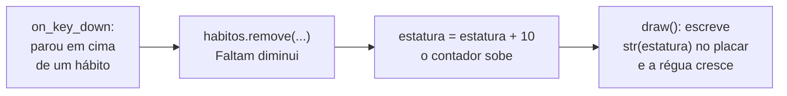

# Módulo 6 — A estatura (material do aluno)

## A ideia de hoje

No Módulo 5 os bons hábitos passaram a sumir quando você passa por cima. Mas o jogo ainda não
**conta** nada: você não sabe quanto já cresceu. Hoje o jogo ganha um **placar** — a sua
**estatura** — que sobe **10** a cada bom hábito, mais um aviso de quantos hábitos **faltam** e
uma **régua** dourada que vai enchendo enquanto você cresce.

> "E crescia Jesus em sabedoria, e em **estatura**, e em graça, para com Deus e os homens."
> (Lucas 2:52)

## O que vamos aprender hoje

- **Contador**: uma variável que começa em `0` e vai **somando** (`estatura = estatura + 10`)
- **`str(...)`**: transforma um **número** em **texto**, para poder juntar com outro texto
- **Placar na tela** (o HUD): textos presos nos cantos com `topleft` e `topright`
- **`screen.draw.rect`**: desenha só a **borda** de um retângulo

## O que você já tem pronto (do Módulo 5)

O seu `jogo.py` (na raiz de `crescendo-como-jesus/`) já tem o `MAPA`, as paredes, o personagem
num quadradinho, o `on_key_down(key)` que anda, respeita as paredes e faz o túnel, a lista
`habitos` lida do mapa, as bolinhas verdes que somem ao coletar e a mensagem de parabéns.

## Primeiro, experimente: o contador

Crie o arquivo **`contador.py` dentro da pasta `aula-06/`** (não no `jogo.py`). É Python puro, e o
resultado aparece no **terminal**. Digite e rode com ▶ **"Run Python File"**:

```python
estatura = 0
print(estatura)

estatura = estatura + 10
estatura = estatura + 10
estatura = estatura + 10
print(estatura)

for numero in range(5):
    estatura = estatura + 10
print(estatura)
```

- `estatura = estatura + 10` é a mesma ordem do `x = x + 5` do Módulo 3: "pegue o valor de agora,
  some 10 e guarde de volta". Uma variável que vai somando assim se chama **contador**.
- Dentro do `for`, a soma acontece **5 vezes**.

**Rode.** No terminal aparece:

```
0
30
80
```

Agora acrescente, embaixo:

```python
print(10 + 10)
print("10" + "10")
print("Estatura: " + estatura)
```

**Rode.** Aparecem `20` e `1010`, e depois o jogo para com um erro:

```
TypeError: can only concatenate str (not "int") to str
```

- `10 + 10` soma **números**: dá `20`. `"10" + "10"` junta **textos**: dá `1010`.
- O erro quer dizer: "eu só sei juntar texto com texto, e `estatura` é um **número**".

Troque a última linha por esta e rode de novo:

```python
print("Estatura: " + str(estatura))
```

- `str(estatura)` transforma o número `80` no texto `"80"`. Agora dá para juntar.

**Rode.** As últimas linhas do terminal ficam `20`, `1010` e **`Estatura: 80`**, sem erro.

## Construindo o placar, passo a passo

Agora volte para o `jogo.py`. Escreva aos poucos e **rode depois de cada passo**. Lembre a regra de
ouro: tudo fica **antes** do `pgzrun.go()`.

### Passo 1 — o contador de estatura

Junto das outras variáveis, logo **depois** das variáveis do personagem (e antes do
`habitos = []`), crie:

```python
# Quanto cada bom hábito faz você crescer
PONTOS_POR_HABITO = 10

# A estatura: um contador. Começa em 0 e cresce a cada bom hábito.
estatura = 0
```

No `on_key_down`, faça duas mudanças:

1. Acrescente `estatura` no fim da linha do `global`:

   ```python
       global personagem_coluna, personagem_linha, estatura
   ```

2. Lá no fim, dentro do `if` que coleta o hábito, acrescente duas linhas **embaixo** do `remove`
   (com o mesmo recuo dele):

   ```python
       if (personagem_coluna, personagem_linha) in habitos:
           habitos.remove((personagem_coluna, personagem_linha))
           estatura = estatura + PONTOS_POR_HABITO
           print(estatura)
   ```

- O `global` precisa do `estatura` porque a função **muda** o valor dele (é o mesmo motivo do
  Módulo 2).
- O `print` é só para conferir: o número aparece no **terminal**.

**Rode e colete alguns hábitos.** A cada bolinha, aparece no terminal o número novo: `10`, `20`,
`30`... Andar por onde não tem hábito não imprime nada.

### Passo 2 — a estatura na tela

Agora o número vai para a janela. **Apague a linha do `print(estatura)`**. Na `draw()`, depois do
`for` que desenha os hábitos, acrescente:

```python
    screen.draw.text(
        "Estatura: " + str(estatura),
        topleft=(10, 8),
        fontsize=28,
        color=COR_DO_TEXTO,
    )
```

O topo da tela vai ficar apertado com a dica comprida. Na mesma `draw()`, troque os dois textos da
`mensagem` por estes, mais curtos:

```python
    if len(habitos) == 0:
        mensagem = "Parabéns! Você cresceu!"
    else:
        mensagem = "Colete os bons hábitos!"
```

- `topleft=(10, 8)` prende o canto de cima, à esquerda, do texto bem no canto da janela.
- `str(estatura)` é o mesmo truque do experimento: sem ele, dá aquele `TypeError`.

**Rode.** No canto de cima, à esquerda, aparece **`Estatura: 0`**. A cada bom hábito, o número
sobe de 10 em 10.

### Passo 3 — quantos faltam

Logo depois do texto da estatura, acrescente outro texto, agora no canto **direito**:

```python
    screen.draw.text(
        "Faltam: " + str(len(habitos)),
        topright=(WIDTH - 10, 8),
        fontsize=28,
        color=COR_DO_TEXTO,
    )
```

- `topright` prende o canto de cima, à **direita**, do texto. `WIDTH - 10` é 10 pixels antes da
  borda direita.
- `len(habitos)` é um número (quantos hábitos ainda estão na lista), por isso também precisa do
  `str`.

**Rode.** No canto direito aparece **`Faltam: 116`**. Esse número **desce** enquanto a estatura
**sobe**.

### Passo 4 — a régua da estatura

Junto das outras cores, crie:

```python
COR_DA_REGUA = "gold"
```

Na `draw()`, depois do texto do pecador (e antes do personagem), acrescente:

```python
    regua = Rect((WIDTH - 400, HEIGHT - 28), (estatura // 3, 16))
    screen.draw.filled_rect(regua, COR_DA_REGUA)
    moldura = Rect((WIDTH - 400, HEIGHT - 28), (386, 16))
    screen.draw.rect(moldura, COR_DO_TEXTO)
```

- A **largura** da régua é `estatura // 3`: começa em `0` e fica mais comprida a cada hábito.
- A estatura máxima é `116 × 10 = 1160`, e `1160 // 3` dá `386`. Por isso a moldura tem `386` de
  largura: é até onde a régua chega quando você coleta tudo.
- `screen.draw.rect` (sem o `filled_`) desenha **só a borda**. É a moldura branca.

**Rode.** No rodapé, à direita, aparece uma **moldura branca vazia**. A cada bom hábito, a régua
dourada cresce um pouquinho lá dentro. Colete todos: a régua enche a moldura, o placar mostra
**`Estatura: 1160`**, o **`Faltam: 0`** e a mensagem **"Parabéns! Você cresceu!"**.

## O que acontece quando você pega um bom hábito



Pronto: compare com o [`exemplo.py`](exemplo.py) deste módulo. É o mesmo código que você acabou de
construir.

## Sua missão

- [ ] Rode o `aula-06/contador.py`, veja o `TypeError` e conserte com `str(...)`;
- [ ] Faça a estatura subir 10 a cada bom hábito (confira no terminal);
- [ ] Mostre a estatura no canto de cima, à esquerda;
- [ ] Mostre quantos hábitos faltam no canto de cima, à direita;
- [ ] Desenhe a régua da estatura com a moldura.

Construa seguindo os passos. Não copie o `exemplo.py` pronto: ele é só para comparar no fim ou
destravar se você empacar.

## Desafios

- **Desafio extra:** crie um **segundo contador**, `passos`, que conta quantos quadradinhos você
  andou, e mostre `"Passos: "` com o número no rodapé, entre o seu nome e a régua (por exemplo
  `center=(310, HEIGHT - 20)` e `fontsize=16`). Dica: o `passos = passos + 1` fica **dentro** do
  `if` da parede, junto com o `personagem_coluna = nova_coluna` (só conta quando anda de verdade).
  Não esqueça o `global`.
- **Desafio criativo:** mude o `PONTOS_POR_HABITO` (o que acontece com a régua se for `20`?);
  troque a cor e a altura da régua; mude o tamanho e a cor das letras do placar.

## Palavras novas

| Termo | O que significa |
|---|---|
| Contador | Uma variável que começa num número (quase sempre `0`) e vai somando |
| `str(...)` | Transforma um número em texto: `str(80)` dá `"80"` |
| `TypeError` | Erro de quando você mistura tipos que não combinam, como juntar texto com número |
| Placar (HUD) | Os textos fixos na tela que mostram como está o jogo: estatura, quantos faltam... |
| `topright=(x, y)` | Prende o canto de cima, à **direita**, do texto naquele ponto |
| `screen.draw.rect(...)` | Desenha só a **borda** de um retângulo (o `filled_rect` pinta ele inteiro) |

## Deu erro? Tenta isso primeiro

- **`TypeError: can only concatenate str (not "int") to str`:** faltou o `str(...)` em volta do
  número. É `"Estatura: " + str(estatura)`.
- **`UnboundLocalError` falando de `estatura` quando pega um hábito:** faltou `estatura` no
  `global` do `on_key_down`.
- **A estatura não sobe:** a linha `estatura = estatura + PONTOS_POR_HABITO` tem que ficar
  **dentro** do `if` que coleta (com o mesmo recuo do `remove`).
- **A estatura sobe mesmo sem pegar hábito:** a linha ficou **fora** do `if` que coleta (com menos
  recuo). Ela tem que ficar embaixo do `remove`.
- **O texto da direita sai cortado ou em cima da dica:** confira se é `topright` (e não `topleft`)
  e `WIDTH - 10`.
- **A régua passa da moldura:** confira o `// 3` na largura da régua e o `386` da moldura. Se você
  mudou o `PONTOS_POR_HABITO`, a conta muda (é um dos desafios criativos!).

Ao final, **salve** o `jogo.py` (na raiz de `crescendo-como-jesus/`) e o `aula-06/contador.py`.
