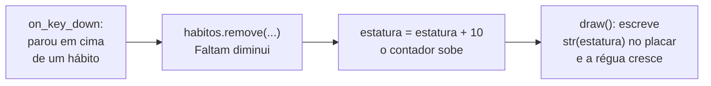

# Módulo 6 — A estatura (material do professor)

**Duração:** 1h30 · **Ferramentas:** Python, VS Code (já configurados desde o Módulo 0)

## O que o aluno já traz do Módulo 5

Este módulo **não instala nada**. Cada aluno já tem o `jogo.py` do Módulo 5: o labirinto lido do
`MAPA`, o personagem morando num quadradinho e andando um quadradinho por aperto no
`on_key_down(key)` (com parede e túnel), a lista `habitos` montada a partir dos `.` do mapa, as
bolinhas verdes que somem ao coletar e a mensagem de parabéns quando a lista fica vazia.

Hoje o jogo passa a **contar**: a **estatura** sobe 10 a cada bom hábito, um placar mostra a
estatura e quantos hábitos faltam, e uma **régua** dourada vai enchendo no rodapé.

## Conceitos

Módulo leve, de **reforço**, com uma ideia central:

- **Contador**: variável que começa em `0` e vai somando (`estatura = estatura + 10`). É o mesmo
  `x = x + 5` do Módulo 3, agora com outro propósito: **contar** em vez de **mover**
- **`str(...)`**: transforma número em texto para juntar com `+`. Sem ele, `TypeError`
- **Placar (HUD)**: textos fixos nos cantos; `topleft` (já visto no Módulo 2) e `topright` (novo)
- **`screen.draw.rect`**: só a borda do retângulo (o `filled_rect` já é conhecido)
- **Número × texto**: `10 + 10` dá `20`, `"10" + "10"` dá `"1010"`

Reforço: `global` (a função muda `estatura`), `len(habitos)`, `//` (divisão inteira, do Módulo
1), `Rect` (Módulo 2).

O contador volta com força no Módulo 7: o **relógio do jogo** é um contador de quadros dentro do
`update()`. Vale dizer isso no fim da aula: "o que vocês aprenderam hoje é o que vai fazer as
tentações andarem sozinhas na próxima".

## Parte do jogo

- `Estatura: 0` no canto superior esquerdo, subindo de 10 em 10 a cada bom hábito.
- `Faltam: 116` no canto superior direito, descendo a cada bom hábito.
- Uma moldura branca no rodapé, à direita, com uma régua dourada que cresce `estatura // 3`
  pixels (cheia quando a estatura chega a 1160, com todos os 116 hábitos).
- A dica do topo fica mais curta para caber entre os dois números: "Colete os bons hábitos!" e,
  no fim, "Parabéns! Você cresceu!".

Ainda **não** há tentações (Módulo 7), vidas (Módulo 8) nem oração especial (Módulo 9). O
personagem continua andando um quadradinho por aperto.

### Ligação com o tema

Lucas 2:52: "crescia Jesus em sabedoria, e em **estatura**...". A estatura do jogo é uma imagem:
cada bom hábito (oração, Bíblia, culto, obedecer aos pais, ajudar o próximo) é um pouquinho de
crescimento, e a régua mostra que ninguém cresce de uma vez. Vale conversar: "o que faz uma
criança crescer por dentro?".

## Roteiro da aula

### 1. Recapitular e apresentar a ideia de hoje (5 min)

- Rodar o jogo do Módulo 5 e coletar alguns hábitos. Perguntar: "quantos eu já peguei? quanto eu
  cresci?" Ninguém sabe: o jogo não conta.
- "Hoje o jogo vai **contar** para a gente, e mostrar na tela."

### 2. Conceitos: contar e transformar número em texto (10 min)

- No quadro: `estatura = 0`, depois `estatura = estatura + 10` três vezes, perguntando o valor a
  cada linha (10, 20, 30). Reforçar que o `=` é "guarde", não "é igual".
- Mostrar `10 + 10` e `"10" + "10"` e pedir que adivinhem o resultado antes de rodar (20 e
  "1010"). As aspas mudam tudo: número soma, texto junta.
- "E se eu quiser juntar texto com número?" Mostrar o `TypeError` e o conserto com `str(...)`.

### 3. Experimentar: o contador no terminal (10 min)

Cada aluno cria `aula-06/contador.py`:

```python
estatura = 0
print(estatura)

estatura = estatura + 10
estatura = estatura + 10
estatura = estatura + 10
print(estatura)

for numero in range(5):
    estatura = estatura + 10
print(estatura)
```

Resultado esperado: `0`, `30`, `80`. Depois acrescentam `print(10 + 10)`, `print("10" + "10")` e
`print("Estatura: " + estatura)`: aparecem `20`, `1010` e o erro
`TypeError: can only concatenate str (not "int") to str`. Trocando a última linha por
`print("Estatura: " + str(estatura))`, aparece `Estatura: 80`.

- O erro é **de propósito**: é o mesmo que vai aparecer no jogo se esquecerem o `str`. Quem viu
  aqui reconhece lá.

### 4. Demonstração: o placar, passo a passo (35 min)

Escrever **ao vivo, rodando depois de cada passo**, no `jogo.py` do Módulo 5.

**Passo 1 — o contador.** Depois das variáveis do personagem (antes do `habitos = []`):
`PONTOS_POR_HABITO = 10` e `estatura = 0`. No `on_key_down`: `estatura` no `global`, e dentro do
`if` da coleta, embaixo do `remove`, `estatura = estatura + PONTOS_POR_HABITO` e um
`print(estatura)`. Rodar: o terminal mostra `10`, `20`, `30`...

- Mostrar o que acontece **sem** o `estatura` no `global`: o jogo fecha com `UnboundLocalError` no
  primeiro hábito, porque a linha **lê** a estatura antes de mudar.
- Perguntar por que a soma fica **dentro** do `if` (só cresce quando pega um hábito).

**Passo 2 — a estatura na tela.** Apagar o `print`. Na `draw()`, depois do `for` dos hábitos:
`screen.draw.text("Estatura: " + str(estatura), topleft=(10, 8), fontsize=28, ...)`. Encurtar
as duas mensagens do topo ("Colete os bons hábitos!" / "Parabéns! Você cresceu!") para não
encavalar com o placar.

**Passo 3 — quantos faltam.** `"Faltam: " + str(len(habitos))` com `topright=(WIDTH - 10, 8)`.
Mostrar que `topright` prende o canto **direito** do texto, por isso o número pode crescer para a
esquerda sem sair da tela. Os dois números andam juntos: um sobe, o outro desce.

**Passo 4 — a régua.** `COR_DA_REGUA = "gold"`. Na `draw()`, depois do texto do pecador:

```python
    regua = Rect((WIDTH - 400, HEIGHT - 28), (estatura // 3, 16))
    screen.draw.filled_rect(regua, COR_DA_REGUA)
    moldura = Rect((WIDTH - 400, HEIGHT - 28), (386, 16))
    screen.draw.rect(moldura, COR_DO_TEXTO)
```

- Fazer a conta com a turma: 116 hábitos × 10 = 1160; 1160 // 3 = 386. Por isso a moldura tem 386.
- A largura do `Rect` vem de uma conta com o contador: é o contador **desenhado**.
- Coletar tudo ao vivo (ou deixar um aluno jogar) até a régua encher.

### O que acontece quando o personagem pega um hábito



### 5. Atividade prática (15 min)

Cada aluno faz os 4 passos no próprio `jogo.py`, seguindo o material do aluno. Critério: placar
subindo, "Faltam" descendo e a régua enchendo até a moldura.

### 6. Desafios (10 min)

- **Missão principal:** placar de estatura, "Faltam" e régua funcionando.
- **Desafio extra:** um segundo contador, `passos`, que soma 1 só quando o personagem **anda de
  verdade** (dentro do `if` da parede), mostrado no rodapé entre o nome e a régua. Reforça
  contador + `global` + `str`.
- **Desafio criativo:** mudar o `PONTOS_POR_HABITO` (com `20`, a régua passa da moldura: bom
  gancho para refazer a conta), cores e tamanhos do placar.

### 7. Revisão e salvamento (5 min)

- O que é um contador? Por que o `str`? Onde o `global` foi necessário?
- Salvar `jogo.py` (na raiz de `crescendo-como-jesus/`) e `aula-06/contador.py`.

## Fundamentos trabalhados

- Variáveis como contadores; atualização `x = x + n`
- Tipos de dados: número (`int`) e texto (`str`), e a conversão com `str(...)`
- Saída na tela (HUD) com posicionamento por canto
- Conta com variáveis para desenhar (`estatura // 3` vira largura)

## Resultado esperado

Ao final, o aluno tem o labirinto com o placar: `Estatura` subindo de 10 em 10, `Faltam` descendo
de 116 a 0 e a régua dourada enchendo a moldura, com "Parabéns! Você cresceu!" no fim.

## Vocabulário novo para os alunos

| Termo | Explicação simples |
|---|---|
| Contador | Variável que começa em 0 e vai somando |
| `str(...)` | Transforma número em texto |
| `TypeError` | Erro de misturar tipos que não combinam (texto + número) |
| Placar (HUD) | Os textos fixos que mostram como está o jogo |
| `topright` | Prende o canto de cima, à direita, do texto |
| `screen.draw.rect` | Desenha só a borda de um retângulo |

## Erros comuns e como ajudar

- **`TypeError: can only concatenate str (not "int") to str`:** faltou `str(...)` em volta do
  número. Lembrar o experimento do terminal.
- **`UnboundLocalError: cannot access local variable 'estatura'` ao pegar um hábito:** faltou
  `estatura` no `global` do `on_key_down`.
- **A estatura sobe sem pegar hábito:** a soma ficou fora do `if` da coleta (recuo menor).
- **A estatura não sobe:** a soma ficou dentro de outro `if` (por exemplo, o do espaço) ou depois
  do `pgzrun.go()`.
- **"Faltam" sai cortado:** usou `topleft` com `WIDTH - 10` (o texto começa ali e sai da tela).
- **A régua aparece cheia logo no começo ou passa da moldura:** conferir o `// 3` e se a largura
  usa `estatura` (e não `len(habitos)`).
