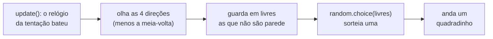

# Módulo 7 — As tentações entram (material do aluno)

## A ideia de hoje

Até agora o labirinto só tinha coisas boas. Hoje entra a primeira **tentação**: a 😡
**desobediência**, uma bolinha vermelha com olhos que **anda sozinha** pelos corredores. Nos
cruzamentos ela **sorteia** para onde vai, então você nunca sabe direito por onde ela vem.

Para o jogo ficar justo, o seu personagem também passa a **andar sozinho**: as setas só escolhem
o caminho, e ele segue até a parede, como no Pac-Man.

Encostar na tentação ainda **não** faz nada. Isso é assunto do Módulo 8.

## O que vamos aprender hoje

- **`import random`**, **`random.randint(...)`** e **`random.choice(...)`**: sortear números e
  escolher um item de uma lista ao acaso
- **O relógio do jogo**: um **contador de quadros** dentro do `update()` para fazer algo andar
  **de tempos em tempos**
- **Direção como um par**: `(1, 0)` é direita, `(0, -1)` é cima
- **O contrário de uma direção**: `(-direcao[0], -direcao[1])`, a **meia-volta**

## O que você já tem pronto (do Módulo 6)

O seu `jogo.py` já tem o labirinto, os bons hábitos, o `on_key_down(key)` que anda um quadradinho
por aperto, e o placar com a estatura, o "Faltam" e a régua.

## Primeiro, experimente: o sorteio

Crie o arquivo **`sorteio.py` dentro da pasta `aula-07/`**. Digite e rode com ▶ **"Run Python
File"**:

```python
import random

print(random.randint(1, 6))
print(random.randint(1, 6))
print(random.randint(1, 6))

caminhos = ["direita", "esquerda", "cima", "baixo"]
for vez in range(5):
    print(random.choice(caminhos))
```

- `import random` traz a biblioteca de **sortear**. Ela já vem com o Python: não precisa instalar.
- `random.randint(1, 6)` sorteia um número **inteiro** de 1 a 6, como um dado.
- `random.choice(caminhos)` escolhe **um item** da lista, ao acaso.

**Rode.** Aparecem três números de 1 a 6 e cinco caminhos. **Rode de novo**: os resultados mudam!
Cada vez sai um sorteio diferente.

Agora acrescente, embaixo:

```python
direcao = (1, 0)
meia_volta = (-direcao[0], -direcao[1])
print(meia_volta)
print(meia_volta != direcao)
```

- No jogo, a direção vai ser um **par**: `(1, 0)` quer dizer "uma coluna para a direita, nenhuma
  linha". O `-` na frente troca o sinal: `-1` vira `1`, `1` vira `-1`.
- Então `(-direcao[0], -direcao[1])` é a direção **contrária**: a meia-volta.

**Rode.** As duas últimas linhas são `(-1, 0)` (a esquerda, o contrário da direita) e `True`.

Por último, apague o `import random` da primeira linha e rode. Aparece:

```
NameError: name 'random' is not defined. Did you forget to import 'random'?
```

O próprio Python pergunta se você esqueceu o `import`. Ponha a linha de volta.

## Construindo as tentações, passo a passo

Agora volte para o `jogo.py`. Escreva aos poucos e **rode depois de cada passo**. Lembre: tudo
fica **antes** do `pgzrun.go()`.

### Passo 1 — o relógio do jogo

O `update()` volta! Junto das outras variáveis, logo **depois** da `estatura = 0` (e antes do
`habitos = []`), crie:

```python
# O relógio do jogo: a cada ESPERA_PERSONAGEM voltas do update(), o personagem anda
ESPERA_PERSONAGEM = 12
quadros_personagem = 0
```

Depois da `draw()` (fora dela, sem recuo), crie a função:

```python
def update():
    global quadros_personagem

    quadros_personagem = quadros_personagem + 1
    if quadros_personagem == ESPERA_PERSONAGEM:
        quadros_personagem = 0
        print("tic")
```

- O Pygame Zero chama o `update()` sozinho, **60 vezes por segundo** (você viu isso no Módulo 3).
- `quadros_personagem` é um **contador** (igual à estatura do Módulo 6): soma 1 a cada volta.
  Quando chega em 12, volta para 0 e faz alguma coisa. 60 voltas ÷ 12 = **5 vezes por segundo**.

**Rode.** O jogo continua igual, mas o **terminal** se enche de `tic`, uns 5 por segundo. Esse é o
"relógio" que vai fazer as coisas andarem sozinhas.

### Passo 2 — o personagem anda sozinho

Logo abaixo das variáveis do relógio, crie:

```python
# A direção é um par: (1, 0) direita, (-1, 0) esquerda, (0, 1) baixo, (0, -1) cima
direcao = (0, 0)           # (0, 0) = parado
proxima_direcao = (0, 0)
```

Agora as setas **não andam mais**: elas só **escolhem** a direção. Troque o seu `on_key_down`
**inteiro** por este (o andar, o túnel, a parede e a coleta saem daqui e vão para o `update()`):

```python
def on_key_down(key):
    global personagem_coluna, personagem_linha, direcao, proxima_direcao

    if key == keys.SPACE:
        personagem_coluna = INICIO_COLUNA
        personagem_linha = INICIO_LINHA
        direcao = (0, 0)
        proxima_direcao = (0, 0)

    if key == keys.RIGHT:
        proxima_direcao = (1, 0)
    if key == keys.LEFT:
        proxima_direcao = (-1, 0)
    if key == keys.DOWN:
        proxima_direcao = (0, 1)
    if key == keys.UP:
        proxima_direcao = (0, -1)
```

E troque o `update()` inteiro por este:

```python
def update():
    global quadros_personagem, personagem_coluna, personagem_linha
    global direcao, estatura

    quadros_personagem = quadros_personagem + 1
    if quadros_personagem == ESPERA_PERSONAGEM:
        quadros_personagem = 0

        direcao = proxima_direcao

        nova_coluna = personagem_coluna + direcao[0]
        nova_linha = personagem_linha + direcao[1]
        if nova_coluna < 0:
            nova_coluna = COLUNAS - 1
        if nova_coluna >= COLUNAS:
            nova_coluna = 0
        if MAPA[nova_linha][nova_coluna] != "#":
            personagem_coluna = nova_coluna
            personagem_linha = nova_linha

        if (personagem_coluna, personagem_linha) in habitos:
            habitos.remove((personagem_coluna, personagem_linha))
            estatura = estatura + PONTOS_POR_HABITO
```

- Você já conhece quase tudo: é o túnel, a parede e a coleta do Módulo 6, só que agora dentro do
  relógio. O `print("tic")` saiu.
- `personagem_coluna + direcao[0]`: com `direcao = (1, 0)`, soma 1 na coluna e 0 na linha. Um par
  no lugar de quatro `if`!
- Para a dica do topo combinar, troque o `"Colete os bons hábitos!"` da `draw()` por
  `"As setas escolhem o caminho!"`.

**Rode.** Aperte → **uma vez só**: o personagem anda sozinho, pega os hábitos pelo caminho e para
na parede. Agora teste: andando pelo corredor de baixo, aperte ↑ **antes** de chegar num
cruzamento. O personagem **para**, de cara para a parede! Vamos consertar.

### Passo 3 — virar na hora certa

O problema: a seta troca a direção **na hora**, mesmo quando ali em cima é parede. O certo é
**guardar** a seta e só virar quando der. No `update()`, troque a linha `direcao = proxima_direcao`
por:

```python
        nova_coluna = personagem_coluna + proxima_direcao[0]
        nova_linha = personagem_linha + proxima_direcao[1]
        if nova_coluna < 0:
            nova_coluna = COLUNAS - 1
        if nova_coluna >= COLUNAS:
            nova_coluna = 0
        if MAPA[nova_linha][nova_coluna] != "#":
            direcao = proxima_direcao
```

- Leia assim: "olhe o quadradinho para onde você **quer** virar. Se lá **não** é parede, vira.
  Se é parede, continua na direção de antes". A seta fica guardada em `proxima_direcao` até dar
  para virar.

**Rode.** Aperte ↑ antes do cruzamento: o personagem **continua** em frente e **vira sozinho** no
primeiro caminho para cima. Agora dá para jogar de verdade!

### Passo 4 — a tentação aparece

Junto das outras cores, crie:

```python
COR_DA_TENTACAO = "crimson"
```

Logo abaixo da `proxima_direcao`, crie:

```python
# A tentação (desobediência) começa no meio do labirinto, olhando para a esquerda
TENTACAO_INICIO_COLUNA = 9
TENTACAO_INICIO_LINHA = 8
tentacao_coluna = TENTACAO_INICIO_COLUNA
tentacao_linha = TENTACAO_INICIO_LINHA
tentacao_direcao = (-1, 0)
```

No **fim** da `draw()`, depois do personagem, desenhe a tentação com dois olhos:

```python
    x = tentacao_coluna * TILE + TILE // 2
    y = tentacao_linha * TILE + TILE // 2
    screen.draw.filled_circle((x, y), TILE // 2 - 4, COR_DA_TENTACAO)
    olhar_x = tentacao_direcao[0] * 2
    olhar_y = tentacao_direcao[1] * 2
    screen.draw.filled_circle((x - 6, y - 4), 5, "white")
    screen.draw.filled_circle((x + 6, y - 4), 5, "white")
    screen.draw.filled_circle((x - 6 + olhar_x, y - 4 + olhar_y), 2, "black")
    screen.draw.filled_circle((x + 6 + olhar_x, y - 4 + olhar_y), 2, "black")
```

- O corpo é o mesmo `filled_circle` do personagem, em vermelho.
- Os olhos são dois círculos brancos, e as **pupilas** (pretas) andam 2 pixels para o lado da
  direção: assim a tentação **olha** para onde vai.

**Rode.** Uma bolinha **vermelha com olhos** aparece parada no corredor do meio, olhando para a
esquerda.

### Passo 5 — a tentação anda e sorteia o caminho

Na **segunda linha** do arquivo, logo abaixo do `import pgzrun`, escreva:

```python
import random
```

Logo abaixo das variáveis da tentação (depois da `tentacao_direcao`), crie:

```python
# As quatro direções que a tentação pode tentar
DIRECOES = [(1, 0), (-1, 0), (0, 1), (0, -1)]

# A tentação tem o relógio dela: é um pouco mais lenta que você
ESPERA_TENTACAO = 16
quadros_tentacao = 0
```

No `update()`, acrescente uma terceira linha de `global` logo abaixo das outras duas:

```python
    global quadros_tentacao, tentacao_coluna, tentacao_linha, tentacao_direcao
```

E, no **fim** do `update()`, **fora** do `if` do personagem (com o mesmo recuo do
`quadros_personagem = quadros_personagem + 1`), acrescente:

```python
    quadros_tentacao = quadros_tentacao + 1
    if quadros_tentacao == ESPERA_TENTACAO:
        quadros_tentacao = 0

        meia_volta = (-tentacao_direcao[0], -tentacao_direcao[1])
        livres = []
        for opcao in DIRECOES:
            if opcao != meia_volta:
                nova_coluna = tentacao_coluna + opcao[0]
                nova_linha = tentacao_linha + opcao[1]
                if nova_coluna < 0:
                    nova_coluna = COLUNAS - 1
                if nova_coluna >= COLUNAS:
                    nova_coluna = 0
                if MAPA[nova_linha][nova_coluna] != "#":
                    livres.append(opcao)

        tentacao_direcao = random.choice(livres)

        tentacao_coluna = tentacao_coluna + tentacao_direcao[0]
        tentacao_linha = tentacao_linha + tentacao_direcao[1]
        if tentacao_coluna < 0:
            tentacao_coluna = COLUNAS - 1
        if tentacao_coluna >= COLUNAS:
            tentacao_coluna = 0
```

Leia em três partes:

1. **Quais caminhos estão livres?** Para cada uma das 4 direções (menos a meia-volta), olha o
   quadradinho vizinho. Se não é parede, guarda a direção na lista `livres` (o `append` do
   Módulo 5).
2. **Sorteia.** `random.choice(livres)` escolhe um dos caminhos livres. Num corredor só tem **um**
   (ela segue em frente); num **cruzamento** tem dois ou três, e aí é sorteio de verdade.
3. **Anda** um quadradinho para lá, com o túnel.

**Rode.** A tentação **anda sozinha**! Ela segue os corredores, sorteia o caminho nos cruzamentos,
nunca dá meia-volta e às vezes até atravessa o túnel. Rode de novo: ela faz outro caminho. Se ela
passar por você, nada acontece por enquanto. No Módulo 8, encostar nela vai custar uma vida.

## Como a tentação decide para onde ir



Pronto: compare com o [`exemplo.py`](exemplo.py) deste módulo. É o mesmo código que você acabou de
construir.

## Sua missão

- [ ] Rode o `aula-07/sorteio.py` e veja o sorteio mudar a cada vez;
- [ ] Faça o relógio do `update()` imprimir `tic` no terminal;
- [ ] Faça o personagem andar sozinho e as setas só escolherem a direção;
- [ ] Faça a seta ficar guardada até dar para virar;
- [ ] Faça a tentação aparecer com olhos;
- [ ] Faça a tentação andar sozinha e sortear o caminho nos cruzamentos.

Construa seguindo os passos. Não copie o `exemplo.py` pronto: ele é só para comparar no fim ou
destravar se você empacar.

## Desafios

- **Desafio extra:** quando o personagem e a tentação estiverem no **mesmo quadradinho**, troque a
  mensagem do topo por `"Cuidado com a tentação!"`. Dica: na `draw()`, depois do `if`/`else` da
  mensagem, compare os dois pares com `==`:
  `(personagem_coluna, personagem_linha) == (tentacao_coluna, tentacao_linha)`.
- **Desafio criativo:** mude o `ESPERA_PERSONAGEM` e o `ESPERA_TENTACAO` (número **menor** é mais
  **rápido**); mude a cor da tentação para outra tentação do jogo, como a 😴 preguiça
  (`"mediumpurple"`); troque o lugar onde ela começa (escolha um quadradinho que não seja `#`!).

## Palavras novas

| Termo | O que significa |
|---|---|
| `import random` | Traz a biblioteca de sortear, que já vem com o Python |
| `random.randint(a, b)` | Sorteia um número inteiro de `a` até `b` (os dois entram) |
| `random.choice(lista)` | Escolhe um item da lista, ao acaso |
| Quadro | Cada volta do `update()` + `draw()`. São uns 60 por segundo |
| Contador de quadros | Um contador que soma 1 a cada quadro para fazer algo acontecer de tempos em tempos |
| Direção como par | `(1, 0)` direita, `(-1, 0)` esquerda, `(0, 1)` baixo, `(0, -1)` cima |
| Meia-volta | A direção contrária: `(-direcao[0], -direcao[1])` |
| `"crimson"` | Um vermelho forte, a cor da tentação |

## Deu erro? Tenta isso primeiro

- **`NameError: name 'random' is not defined`:** falta o `import random` lá em cima, na segunda
  linha do arquivo.
- **O terminal não mostra `tic`:** confira se a função se chama **exatamente** `update`, se está
  **antes** do `pgzrun.go()` e se o `if` compara com `==` (não `=`).
- **`UnboundLocalError` quando o jogo abre:** falta alguma variável no `global` do `update()`
  (as do personagem, a `direcao`, a `estatura` ou as da tentação).
- **O personagem não anda quando aperta a seta:** o `on_key_down` só muda a `proxima_direcao`.
  Confira se o `update()` está com as mudanças dos Passos 2 e 3.
- **O personagem anda dois quadradinhos de uma vez ou corre demais:** sobrou o andar antigo no
  `on_key_down`. Ele tem que ficar só com o espaço e as quatro setas.
- **`IndexError: Cannot choose from an empty sequence` quando a tentação anda:** a lista `livres`
  ficou vazia: a tentação está num lugar sem saída. Confira se o `TENTACAO_INICIO_COLUNA` e o
  `TENTACAO_INICIO_LINHA` apontam para um corredor (não para um `#`) e, se você mudou o mapa, se
  não criou um beco sem saída.
- **A tentação fica indo e voltando no mesmo lugar:** o `if opcao != meia_volta:` está com `==`.
  Tem que ser `!=` (diferente).
- **A tentação atravessa paredes:** o `livres.append(opcao)` tem que ficar **dentro** do `if` da
  parede, com mais recuo.
- **A tentação só anda para um lado e some:** faltou o túnel dela (os dois últimos `if`).

Ao final, **salve** o `jogo.py` (na raiz de `crescendo-como-jesus/`) e o `aula-07/sorteio.py`.
