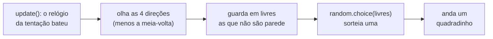

# Módulo 7 — As tentações entram (material do professor)

**Duração:** 1h30 · **Ferramentas:** Python, VS Code (já configurados desde o Módulo 0)

## O que o aluno já traz do Módulo 6

Este módulo **não instala nada** (o `random` já vem com o Python). Cada aluno já tem o `jogo.py`
do Módulo 6: labirinto, bons hábitos, o `on_key_down(key)` que anda um quadradinho por aperto
(com parede, túnel e coleta) e o placar com `Estatura`, `Faltam` e a régua.

Hoje entra a primeira **tentação** (😡 desobediência): uma bolinha vermelha com olhos que anda
sozinha e **sorteia** o caminho nos cruzamentos. Para o jogo ficar justo, o personagem também passa
a **andar sozinho**: as setas só escolhem a direção, como no Pac-Man. Encostar na tentação ainda
não faz nada: vidas são do Módulo 8.

## Conceitos

- **`import random`**, **`random.randint(a, b)`** e **`random.choice(lista)`**: o acaso.
  `random` vem com o Python (biblioteca padrão), diferente do `pgzero`, que foi instalado
- **Relógio do jogo**: um **contador de quadros** dentro do `update()` (o contador do Módulo 6).
  O `update()` roda 60 vezes por segundo; com `ESPERA = 12`, algo acontece 5 vezes por segundo
- **Direção como par**: `(1, 0)`, `(-1, 0)`, `(0, 1)`, `(0, -1)` (pares são do Módulo 5).
  `coluna + direcao[0]` substitui quatro `if`
- **Direção contrária**: `(-direcao[0], -direcao[1])`, o sinal de menos na frente
- **Guardar a intenção**: `proxima_direcao` (o que a criança pediu) × `direcao` (para onde está
  indo de fato). Só vira quando dá

Reforço: `for` em lista, lista vazia + `append` (Módulo 5), `!=`, `global`, túnel (Módulo 4).

### Por que o personagem muda de jeito de andar justo hoje

Está registrado em `docs/design-do-jogo.md` (decisão de 2026-09-29): dos Módulos 4 a 6 o
personagem anda um quadradinho por aperto; a partir do 7 anda sozinho, com contador de quadros,
porque a tentação precisa **do mesmo** jeito de andar. Ensinando primeiro no personagem (que a
criança controla e entende), a tentação vira "a mesma coisa, só que sorteando".

### A aula é pesada

São duas novidades grandes (o personagem anda sozinho; a tentação com sorteio). Como no Módulo 4,
é esperado que parte da turma termine os Passos 4 e 5 no começo do Módulo 8. O corte natural é
depois do Passo 3 (o personagem já anda e vira bem): dá para parar ali sem deixar o jogo quebrado.

### Repetição de código

O túnel aparece **três vezes** no `update()` (para virar, para andar e na tentação). É de
propósito: no Módulo 8 entram as funções (`def`), e esse é o melhor exemplo de "código repetido
que merece um nome". Se alguém reclamar, ótimo: "guarda essa reclamação para a próxima aula".

### Não tem beco sem saída

A tentação nunca dá meia-volta. Isso só funciona porque o labirinto do curso **não tem beco sem
saída** (conferido por script: todo quadradinho livre tem pelo menos 2 vizinhos livres). Se um
aluno desenhar o próprio mapa com beco, a lista `livres` fica vazia ali e o jogo fecha com
`IndexError: Cannot choose from an empty sequence`. A saída é não fazer beco (ou, como desafio,
permitir a meia-volta quando `len(livres) == 0`).

## Parte do jogo

- O personagem anda sozinho, um quadradinho a cada 12 quadros (5 por segundo). A seta guardada
  vale no primeiro cruzamento onde dá para virar. Para na parede. Espaço volta ao início parado.
- A tentação começa em `(9, 8)`, no corredor do meio, e anda um quadradinho a cada 16 quadros (um
  pouco mais lenta). Nos corredores segue em frente; nos cruzamentos sorteia; nunca volta; passa
  pelo túnel.
- Os olhos da tentação olham para onde ela vai (as pupilas andam 2 pixels na direção).

## Roteiro da aula

### 1. Recapitular e apresentar a ideia de hoje (5 min)

- Rodar o jogo do Módulo 6. "Está fácil demais. Falta o quê?" (algo que atrapalhe).
- Mostrar o jogo de referência (`jogo/jogo.py`) com as tentações andando. "Como elas sabem para
  onde ir?" Deixar a turma chutar: "sorteiam!".

### 2. Conceitos: o acaso e o relógio (10 min)

- **Acaso**: um dado. `random.randint(1, 6)`. Uma lista de caminhos e `random.choice`.
- **Relógio**: o `update()` do Módulo 3 rodava 60 vezes por segundo e movia 5 pixels por vez.
  Agora queremos andar um **quadradinho inteiro** de tempos em tempos: contar as voltas e, a cada
  12, andar. Desenhar no quadro: `1, 2, 3, ..., 12 → anda e volta para 0`.
- **Direção como par**: desenhar uma rosa dos ventos com `(1, 0)`, `(-1, 0)`, `(0, 1)`, `(0, -1)`.
  Lembrar que o `y` (a linha) cresce para baixo.

### 3. Experimentar: o sorteio no terminal (10 min)

Cada aluno cria `aula-07/sorteio.py`:

```python
import random

print(random.randint(1, 6))
print(random.randint(1, 6))
print(random.randint(1, 6))

caminhos = ["direita", "esquerda", "cima", "baixo"]
for vez in range(5):
    print(random.choice(caminhos))

direcao = (1, 0)
meia_volta = (-direcao[0], -direcao[1])
print(meia_volta)
print(meia_volta != direcao)
```

- Rodar **duas ou três vezes**: os números e caminhos mudam a cada vez; as duas últimas linhas são
  sempre `(-1, 0)` e `True`.
- Pedir que apaguem o `import random` e rodem: `NameError: name 'random' is not defined. Did you
  forget to import 'random'?`. O próprio Python sugere a resposta.

### 4. Demonstração: o personagem anda sozinho (25 min)

**Passo 1 — o relógio.** Depois da `estatura = 0`: `ESPERA_PERSONAGEM = 12` e
`quadros_personagem = 0`. O `update()` volta (depois da `draw()`), com o contador e um
`print("tic")`. Rodar: uns 5 `tic` por segundo no terminal.

**Passo 2 — andar sozinho.** `direcao` e `proxima_direcao` como pares (começam em `(0, 0)`). O
`on_key_down` fica só com o espaço e as quatro setas mudando a `proxima_direcao`. O `update()`
recebe o andar (direção, túnel, parede, coleta), com `direcao = proxima_direcao` direto. Trocar a
dica para "As setas escolhem o caminho!".

- Rodar e **mostrar o defeito de propósito**: andando no corredor de baixo, apertar ↑ antes do
  cruzamento. O personagem para, de cara para a parede. "Como o Pac-Man faz?"

**Passo 3 — virar na hora certa.** Trocar `direcao = proxima_direcao` pelo teste: olhar o
quadradinho na `proxima_direcao`; só vira se não for parede. Rodar de novo o mesmo teste: agora ele
continua e vira sozinho no primeiro caminho para cima.

- Se precisar cortar a aula, este é o ponto.

### 5. Demonstração: a tentação (20 min)

**Passo 4 — aparece.** Cor `"crimson"`, posição `(9, 8)`, `tentacao_direcao = (-1, 0)`. No fim
da `draw()`, o círculo e os olhos (pupilas deslocadas pela direção × 2). Rodar: ela aparece parada,
olhando para a esquerda.

**Passo 5 — anda e sorteia.** `import random` na segunda linha; `DIRECOES`, `ESPERA_TENTACAO = 16`
e `quadros_tentacao`; a terceira linha de `global`; e o bloco no fim do `update()`:

1. `meia_volta` e a lista `livres` (as direções que não são meia-volta nem dão em parede);
2. `random.choice(livres)`;
3. anda, com túnel.

- Perguntar: "num corredor reto, quantas direções ficam em `livres`?" (uma: segue em frente).
  "E num cruzamento em T?" (duas). O sorteio só "aparece" nos cruzamentos.
- Rodar duas vezes: o caminho muda. Deixar a turma acompanhar a tentação com o dedo.

### Como a tentação decide para onde ir



### 6. Atividade prática e desafios (15 min)

- **Missão principal:** personagem andando sozinho e virando na hora certa; tentação andando e
  sorteando.
- **Desafio extra:** mensagem "Cuidado com a tentação!" quando os dois pares
  `(personagem_coluna, personagem_linha)` e `(tentacao_coluna, tentacao_linha)` forem iguais
  (`==` entre pares; sem `and`, que só vem no Módulo 9). É a ponte para o Módulo 8.
- **Desafio criativo:** velocidades (`ESPERA` menor = mais rápido), cor de outra tentação (😴
  preguiça em `"mediumpurple"`), outro ponto de partida (que não seja `#`).

### 7. Revisão e salvamento (5 min)

- O que faz o `random.choice`? Por que o contador de quadros? Por que a seta fica "guardada"?
- Salvar `jogo.py` e `aula-07/sorteio.py`.

## Fundamentos trabalhados

- Aleatoriedade com a biblioteca padrão (`random`)
- Tempo no jogo com contador de quadros
- Representar direções com pares; inverter com `-`
- Montar uma lista de opções com `for` + `if` + `append` e escolher uma
- Separar intenção (`proxima_direcao`) de estado (`direcao`)

## Resultado esperado

O personagem anda sozinho pelo labirinto, guiado pelas setas, virando no primeiro cruzamento
possível e coletando hábitos (o placar do Módulo 6 continua funcionando). Uma tentação vermelha
com olhos anda sozinha, sorteando o caminho nos cruzamentos, sem dar meia-volta e passando pelo
túnel. Encostar nela ainda não tem efeito.

## Vocabulário novo para os alunos

| Termo | Explicação simples |
|---|---|
| `random` | A biblioteca de sortear (já vem com o Python) |
| `random.randint(a, b)` | Sorteia um número inteiro de `a` a `b` |
| `random.choice(lista)` | Escolhe um item da lista ao acaso |
| Quadro | Uma volta do `update()` + `draw()`; uns 60 por segundo |
| Contador de quadros | Faz algo acontecer de tempos em tempos |
| Direção como par | `(1, 0)` direita, `(0, -1)` cima... |
| Meia-volta | A direção contrária, com o `-` na frente |

## Erros comuns e como ajudar

- **`NameError: name 'random' is not defined`:** falta o `import random`.
- **`UnboundLocalError` assim que o jogo abre:** alguma variável que o `update()` muda não está no
  `global` (o contador, a direção, a estatura ou as da tentação). O erro diz qual.
- **Nada anda e não aparece `tic`:** o `update()` está depois do `pgzrun.go()`, ou com outro nome,
  ou o `if` usa `=` em vez de `==` (aí é `SyntaxError`).
- **O personagem anda e também pula quadradinhos ao apertar:** sobrou o andar antigo no
  `on_key_down`.
- **O personagem para de cara para a parede ao apertar antes do cruzamento:** o Passo 3 não foi
  feito (ainda está `direcao = proxima_direcao` direto).
- **`IndexError: Cannot choose from an empty sequence`:** `livres` ficou vazia, a tentação está
  sem saída: começou dentro de um `#` cercado de paredes, ou o aluno desenhou um mapa com beco sem
  saída.
- **A tentação fica indo e voltando entre dois quadradinhos:** `==` no lugar de `!=` no
  `if opcao != meia_volta` (aí a **única** opção livre é justamente a meia-volta).
- **A tentação atravessa paredes:** o `livres.append(opcao)` ficou com o recuo do `for`, fora do
  `if` da parede.
- **A tentação some pela lateral:** faltou o túnel dela (os dois últimos `if`).
