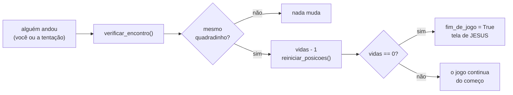

# Módulo 8 — Encostar na tentação (material do aluno)

## A ideia de hoje

A tentação já anda pelo labirinto, mas passar por ela não acontece nada. Hoje isso muda: você
começa com **3 vidas**, e cada vez que a tentação te alcança você **perde uma** e os dois voltam
para o começo. Quando as vidas acabam, aparece a tela de fim de jogo.

E essa tela não diz que o mal venceu. Ela lembra quem já venceu:

> "Em todas estas coisas somos mais que vencedores, por meio daquele que nos amou."
> (Romanos 8:37)

Para fazer tudo isso sem repetir código, você vai aprender a criar as suas **próprias funções**
com `def`.

## O que vamos aprender hoje

- **Criar uma função** com `def` e **chamar** a função pelo nome, com `()`
- **Parâmetro**: um valor que a função recebe entre os parênteses
- **`return`**: a função **devolve** um resultado (e sai na hora)
- **Uma função chamando outra**
- **Vidas**: um contador que **desce**
- **Fim de jogo**: uma variável `True`/`False` que para o jogo

## O que você já tem pronto (do Módulo 7)

O seu `jogo.py` já tem o labirinto, os bons hábitos, o placar com a régua, o personagem andando
sozinho (as setas só escolhem a direção) e a tentação vermelha que sorteia o caminho nos
cruzamentos. Repare numa coisa: o **túnel** (aqueles dois `if` que trocam a coluna quando ela sai
da tela) aparece **quatro vezes** no seu `update()`. Hoje ele vira uma função.

## Primeiro, experimente: as suas funções

Crie o arquivo **`funcoes.py` dentro da pasta `aula-08/`**. Digite e rode com ▶ **"Run Python
File"**:

```python
def boas_vindas():
    print("Olá!")
    print("Vamos crescer como Jesus.")


boas_vindas()
boas_vindas()
```

- `def boas_vindas():` **cria** uma função chamada `boas_vindas`. O que está recuado embaixo é o
  que ela faz. Você já fez isso com a `draw()`, mas quem chamava a `draw()` era o Pygame Zero.
- `boas_vindas()` **chama** a função: o Python vai lá e faz o que está dentro dela. Chamou duas
  vezes, ela faz duas vezes.

**Rode.** No terminal aparece, duas vezes:

```
Olá!
Vamos crescer como Jesus.
```

Agora acrescente, embaixo:

```python
def dobro(numero):
    return numero * 2


print(dobro(5))
print(dobro(21))
```

- `numero` é um **parâmetro**: o valor que a função **recebe** entre os parênteses. Em
  `dobro(5)`, o `numero` vale `5`; em `dobro(21)`, vale `21`.
- `return` **devolve** o resultado para quem chamou. É por isso que dá para pôr `dobro(5)` dentro
  do `print`.

**Rode.** Aparecem mais duas linhas: `10` e `42`.

Por último, a função que vai para o jogo:

```python
def corrige_tunel(coluna):
    if coluna < 0:
        return 19
    if coluna >= 20:
        return 0
    return coluna


print(corrige_tunel(-1))
print(corrige_tunel(20))
print(corrige_tunel(7))
```

- Saiu pela esquerda (`-1`)? Devolve `19`. Saiu pela direita (`20`)? Devolve `0`. Senão, devolve
  a mesma coluna.
- O `return` também faz a função **sair na hora**: quando ela devolve `19`, as linhas de baixo
  nem rodam.

**Rode.** As últimas linhas são `19`, `0` e `7`.

### Erre de propósito

- Troque `print(dobro(5))` por `print(dobro)` (sem os parênteses) e rode. Aparece algo como
  `<function dobro at 0x...>`: sem os `()`, a função **não é chamada**, o Python só mostra que
  ela existe. Volte os parênteses.
- Apague a palavra `return` da função `dobro` (deixe só `numero * 2`) e rode. O `print(dobro(5))`
  mostra **`None`**, que quer dizer "nada": a conta foi feita, mas a função não devolveu.
  Ponha o `return` de volta.

## Construindo as vidas, passo a passo

Agora volte para o `jogo.py`. Escreva aos poucos e **rode depois de cada passo**. Lembre: tudo
fica **antes** do `pgzrun.go()`.

### Passo 1 — o túnel vira uma função

Logo **antes** do `def draw():` (fora de qualquer função, sem recuo), crie:

```python
# ---------------- as nossas funções ----------------

def corrige_tunel(coluna):
    # Saiu por um lado? Devolve a coluna do outro lado. Senão, devolve a mesma.
    if coluna < 0:
        return COLUNAS - 1
    if coluna >= COLUNAS:
        return 0
    return coluna
```

Agora, no `update()`, troque cada um dos **quatro** túneis por uma chamada da função. Os três
primeiros têm este formato (a parte da direção muda em cada um):

```python
        nova_coluna = personagem_coluna + proxima_direcao[0]
        nova_linha = personagem_linha + proxima_direcao[1]
        if nova_coluna < 0:
            nova_coluna = COLUNAS - 1
        if nova_coluna >= COLUNAS:
            nova_coluna = 0
```

e viram assim (os quatro `if` somem):

```python
        nova_coluna = corrige_tunel(personagem_coluna + proxima_direcao[0])
        nova_linha = personagem_linha + proxima_direcao[1]
```

Faça o mesmo com o `personagem_coluna + direcao[0]` (o andar do personagem) e com o
`tentacao_coluna + opcao[0]` (os caminhos livres da tentação). O quarto túnel é o da tentação
andando:

```python
        tentacao_coluna = tentacao_coluna + tentacao_direcao[0]
        tentacao_linha = tentacao_linha + tentacao_direcao[1]
        if tentacao_coluna < 0:
            tentacao_coluna = COLUNAS - 1
        if tentacao_coluna >= COLUNAS:
            tentacao_coluna = 0
```

e vira:

```python
        tentacao_coluna = corrige_tunel(tentacao_coluna + tentacao_direcao[0])
        tentacao_linha = tentacao_linha + tentacao_direcao[1]
```

- A função **não precisa** de `global`: ela só **lê** o `COLUNAS`, não muda nada lá fora.

**Rode.** O jogo funciona **igualzinho** a antes: o personagem e a tentação ainda passam pelo
túnel. A diferença está no código: os quatro túneis (16 linhas de `if`) viraram **uma** função, e
agora o túnel está num lugar só. Se um dia precisar mudar o túnel, você muda num lugar, não em
quatro.

### Passo 2 — as vidas

Logo **depois** da `estatura = 0`, crie:

```python
# As vidas: um contador que DESCE. Encostou na tentação, perde uma.
VIDAS_INICIAIS = 3
vidas = VIDAS_INICIAIS
```

Na `draw()`, logo depois da moldura da régua, desenhe uma bolinha para cada vida:

```python
    for numero in range(vidas):
        screen.draw.filled_circle((250 + numero * 30, HEIGHT - 20), 9, personagem_cor)
```

- `range(vidas)` dá `0, 1, 2` quando `vidas` é 3. Cada bolinha fica 30 pixels à direita da
  anterior: em `250`, `280` e `310`.

**Rode.** No rodapé, entre o seu nome e a régua, aparecem **3 bolinhas douradas**: as suas vidas.

### Passo 3 — a função que reinicia as posições

Logo **depois** da `corrige_tunel`, crie:

```python
def reiniciar_posicoes():
    # Coloca o personagem e a tentação de volta no começo, parados
    global personagem_coluna, personagem_linha, direcao, proxima_direcao
    global tentacao_coluna, tentacao_linha, tentacao_direcao

    personagem_coluna = INICIO_COLUNA
    personagem_linha = INICIO_LINHA
    direcao = (0, 0)
    proxima_direcao = (0, 0)
    tentacao_coluna = TENTACAO_INICIO_COLUNA
    tentacao_linha = TENTACAO_INICIO_LINHA
    tentacao_direcao = (-1, 0)
```

Esta função **muda** variáveis de fora, então precisa do `global` (o mesmo de sempre).

Agora use a função no `on_key_down`. Troque o `global` e o `if` do espaço por:

```python
def on_key_down(key):
    global proxima_direcao

    if key == keys.SPACE:
        reiniciar_posicoes()
```

(as quatro setas continuam iguais embaixo).

**Rode.** Ande um pouco e aperte **espaço**: agora o personagem **e** a tentação voltam para o
começo.

### Passo 4 — encostar na tentação

Logo **depois** da `reiniciar_posicoes`, crie:

```python
def verificar_encontro():
    # O personagem e a tentação estão no mesmo quadradinho? Perde uma vida.
    global vidas

    if (personagem_coluna, personagem_linha) == (tentacao_coluna, tentacao_linha):
        vidas = vidas - 1
        reiniciar_posicoes()
```

- `==` entre dois **pares** compara os dois números de uma vez: mesma coluna **e** mesma linha.
- Uma função pode **chamar outra**: a `verificar_encontro` chama a `reiniciar_posicoes`.

Agora chame a função em **dois** lugares do `update()`:

1. Depois que o **personagem** anda (no fim do `if` do relógio dele, embaixo da coleta):

   ```python
           if (personagem_coluna, personagem_linha) in habitos:
               habitos.remove((personagem_coluna, personagem_linha))
               estatura = estatura + PONTOS_POR_HABITO

           verificar_encontro()
   ```

2. Depois que a **tentação** anda (no fim do `if` do relógio dela, embaixo do túnel dela):

   ```python
           tentacao_coluna = corrige_tunel(tentacao_coluna + tentacao_direcao[0])
           tentacao_linha = tentacao_linha + tentacao_direcao[1]

           verificar_encontro()
   ```

- Por que nos dois? Se você só olhar depois que o personagem anda, a tentação pode **andar para
  cima de você** e ninguém perceber. Olhando depois de cada um andar, ninguém atravessa ninguém.

**Rode.** Deixe a tentação te alcançar: **uma bolinha some** e os dois voltam para o começo.
Depois da terceira vez, as bolinhas acabam... mas o jogo continua! Isso a gente arruma agora.

### Passo 5 — o fim de jogo

Logo **depois** das vidas, crie:

```python
# Quando as vidas acabam, o jogo para e mostra a tela de fim de jogo
fim_de_jogo = False
```

Na `verificar_encontro`, ponha `fim_de_jogo` no `global` e, **dentro** do `if` do encontro,
embaixo do `reiniciar_posicoes()`, acrescente:

```python
    global vidas, fim_de_jogo

    if (personagem_coluna, personagem_linha) == (tentacao_coluna, tentacao_linha):
        vidas = vidas - 1
        reiniciar_posicoes()
        if vidas == 0:
            fim_de_jogo = True
```

E no `update()`, logo **depois** das três linhas de `global`, acrescente:

```python
    if fim_de_jogo:
        return
```

- O `return` também funciona numa função que não devolve nada: ele faz o `update()` **sair na
  hora**. Com o fim de jogo, nada mais anda.

**Rode.** Perca as 3 vidas: na terceira, o jogo **congela**. Ninguém anda mais. Falta a tela.

### Passo 6 — a tela de fim de jogo

Logo **depois** da `verificar_encontro`, crie a função que desenha a tela:

```python
def desenhar_derrota():
    # Na derrota, o destaque é para JESUS: é Ele quem venceu.
    screen.fill("midnightblue")
    screen.draw.text("JESUS", center=(WIDTH // 2, 110), fontsize=90, color="gold")
    screen.draw.text("já venceu na cruz.", center=(WIDTH // 2, 185), fontsize=34, color=COR_DO_TEXTO)
    screen.draw.text(
        "O mal nunca tem a última palavra.",
        center=(WIDTH // 2, 225),
        fontsize=26,
        color=COR_DO_TEXTO,
    )

    linhas = [
        "Persevere todos os dias:",
        "oração, Bíblia, culto,",
        "obediência e ajudar o próximo.",
        "",
        "Em todas estas coisas somos mais que vencedores,",
        "por meio daquele que nos amou. (Romanos 8:37)",
    ]
    y = 295
    for linha in linhas:
        screen.draw.text(linha, center=(WIDTH // 2, y), fontsize=24, color=COR_DO_TEXTO)
        y = y + 32

    screen.draw.text(
        "Estatura alcançada: " + str(estatura),
        center=(WIDTH // 2, 520),
        fontsize=30,
        color="gold",
    )
```

- As frases do meio estão numa **lista**, e o `for` desenha uma de cada vez, descendo 32 pixels
  a cada linha. O `""` é uma linha vazia, para dar um respiro.

E no **começo** da `draw()`, antes do `screen.fill(COR_DE_FUNDO)`, acrescente:

```python
def draw():
    if fim_de_jogo:
        desenhar_derrota()
        return

    screen.fill(COR_DE_FUNDO)
```

**Rode e perca as 3 vidas.** A tela fica **azul-escura**, com **JESUS** em dourado, "já venceu na
cruz.", o convite para perseverar, Romanos 8:37 e a sua estatura.

## O que acontece quando a tentação te alcança



Pronto: compare com o [`exemplo.py`](exemplo.py) deste módulo. É o mesmo código que você acabou de
construir.

## Sua missão

- [ ] Rode o `aula-08/funcoes.py` e veja o `def`, o parâmetro e o `return` funcionando;
- [ ] Troque os quatro túneis pela função `corrige_tunel`;
- [ ] Mostre as 3 vidas como bolinhas no rodapé;
- [ ] Crie a `reiniciar_posicoes` e use no espaço;
- [ ] Faça a tentação tirar uma vida ao te alcançar;
- [ ] Pare o jogo e mostre a tela de JESUS quando as vidas acabarem.

Construa seguindo os passos. Não copie o `exemplo.py` pronto: ele é só para comparar no fim ou
destravar se você empacar.

## Desafios

- **Desafio extra:** faça a tecla **Enter** começar um **jogo novo** depois do fim de jogo. Crie
  uma função `novo_jogo()` que monta a lista `habitos` de novo (o mesmo `for` dentro de `for`),
  zera a estatura, devolve as vidas, desliga o `fim_de_jogo` e chama a `reiniciar_posicoes()`. No
  `on_key_down`, use um `if` dentro do outro: `if key == keys.RETURN:` e, dentro dele,
  `if fim_de_jogo:`. Não esqueça o `global`. E escreva `"Aperte ENTER para jogar de novo"` na
  tela de fim de jogo.
- **Desafio criativo:** mude o `VIDAS_INICIAIS` (o jogo fica mais fácil com 5?); desenhe as vidas
  como quadradinhos; troque as cores da tela de fim de jogo; acrescente uma frase sua de
  encorajamento na lista `linhas`.

## Palavras novas

| Termo | O que significa |
|---|---|
| Função (a sua) | Um pedaço de código com nome, criado com `def`, que você chama quando quiser |
| Chamar uma função | Escrever o nome dela com `()`, como `reiniciar_posicoes()` |
| Parâmetro | Um valor que a função recebe entre os parênteses, como o `coluna` de `corrige_tunel(coluna)` |
| `return` | Devolve um resultado para quem chamou e sai da função na hora |
| `None` | "Nada": o que uma função devolve quando não tem `return` |
| Vidas | Um contador que desce a cada encontro com a tentação |
| Fim de jogo | Uma variável `True`/`False` que faz o jogo parar |
| `"midnightblue"` | Um azul bem escuro, a cor da tela de fim de jogo |

## Deu erro? Tenta isso primeiro

- **`NameError: name 'corrige_tunel' is not defined`:** o nome está escrito diferente na criação
  (`def`) e na chamada, ou a função foi criada **depois** do `pgzrun.go()`.
- **`TypeError: string indices must be integers, not 'NoneType'`:** faltou o último
  `return coluna` na `corrige_tunel`. Sem ele, a função devolve `None` (nada) para as colunas do
  meio.
- **O personagem some pela lateral esquerda:** o primeiro `if` da `corrige_tunel` tem que
  **devolver** com `return COLUNAS - 1`, e não guardar numa variável.
- **O espaço não faz nada:** escreveu `reiniciar_posicoes` sem os `()`. Sem eles, a função não é
  chamada.
- **`UnboundLocalError` falando de `vidas` quando a tentação encosta:** faltou o `global vidas`
  na `verificar_encontro`.
- **A tentação passa por você e nada acontece:** faltou chamar a `verificar_encontro()` no
  `update()`, ou ela ficou fora do `if` do relógio (com o recuo errado).
- **Perde várias vidas de uma vez:** a `reiniciar_posicoes()` não está sendo chamada dentro do
  `if` do encontro (os dois continuam no mesmo lugar).
- **As vidas acabam e o jogo continua:** falta o `if fim_de_jogo: return` no começo do `update()`,
  ou o `fim_de_jogo = True` está fora do `if vidas == 0:`.
- **As vidas acabam, o labirinto fica parado e a tela de JESUS não aparece:** falta o `return`
  logo depois do `desenhar_derrota()` na `draw()`. Sem ele, o labirinto é desenhado por cima da
  tela de fim de jogo.

Ao final, **salve** o `jogo.py` (na raiz de `crescendo-como-jesus/`) e o `aula-08/funcoes.py`.
