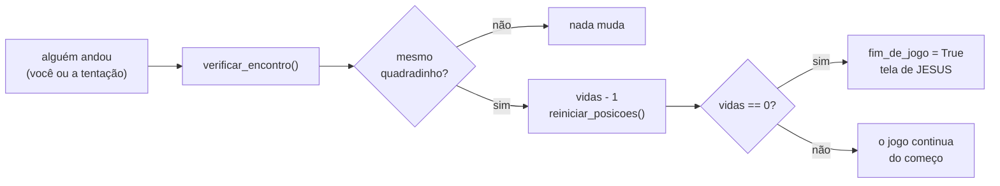

# Módulo 8 — Encostar na tentação (material do professor)

**Duração:** 1h30 · **Ferramentas:** Python, VS Code (já configurados desde o Módulo 0)

## O que o aluno já traz do Módulo 7

Este módulo **não instala nada**. Cada aluno já tem o `jogo.py` do Módulo 7: labirinto, bons
hábitos, placar com régua, o personagem andando sozinho (com `proxima_direcao` guardada) e a
tentação vermelha que sorteia o caminho nos cruzamentos. Se alguém parou no Passo 3 do Módulo 7
(sem tentação), termina os Passos 4 e 5 de lá no começo da aula: hoje a tentação é essencial.

Hoje encostar na tentação passa a **custar uma vida**; com 3 vidas perdidas, aparece a tela de fim
de jogo. E entram as **funções próprias** (`def`), que resolvem um problema que a turma já sente:
o túnel repetido quatro vezes no `update()`.

## Conceitos

- **Criar e chamar uma função**: `def nome():` e `nome()`. Até aqui o aluno só **escreveu**
  funções que o Pygame Zero chamava (`draw`, `update`, `on_key_down`); hoje ele **chama** as dele
- **Parâmetro**: o valor entre os parênteses (`corrige_tunel(coluna)`)
- **`return`**: devolve um resultado e sai da função na hora. Sem `return`, a função devolve
  `None`. `return` sozinho (sem valor) só sai: é o que para o `update()` e a `draw()` no fim de jogo
- **Uma função chamando outra** (`verificar_encontro` chama `reiniciar_posicoes`)
- **`global` só para quem muda**: `corrige_tunel` só lê `COLUNAS` e não precisa; as outras mudam
  variáveis de fora e precisam
- **Contador que desce** (vidas) e **estado do jogo** com `True`/`False` (`fim_de_jogo`)

Reforço: `==` entre pares (Módulo 5/7), lista + `for` para desenhar várias linhas de texto
(Módulos 4-5), `str()` (Módulo 6).

### Por que o `def` entra justo aqui

A tabela do curso põe "funções (`def`)" no Módulo 8. Os Módulos 1-7 já usavam `def`, mas só para
as funções **especiais** que o Pygame Zero chama sozinho. A novidade de hoje é criar funções
**nossas**, com nome que a gente escolhe, e chamar quando quiser. O gancho é concreto: no Módulo 7
o túnel ficou copiado quatro vezes (de propósito). Começar mostrando esse código repetido e
perguntar "e se eu quiser mudar o túnel?" vende a ideia sozinho.

### Por que verificar o encontro duas vezes

O personagem anda a cada 12 quadros e a tentação a cada 16. Se o jogo só comparasse as posições
depois que **um** deles anda, os dois poderiam trocar de lugar (cruzar no corredor) sem nunca
ficar no mesmo quadradinho. Chamando a `verificar_encontro()` depois de **cada** um andar, isso
não acontece. Foi conferido por script: 289 combinações de velocidades com os dois andando um
contra o outro, e nenhuma passou sem perder vida.

### A tela de fim de jogo

Segue o `docs/design-do-jogo.md` e a demo (`jogo/jogo.py`): o jogo **nunca** diz que o mal
venceu. O destaque é **JESUS**, que "já venceu na cruz", com o convite a perseverar nas disciplinas
espirituais e Romanos 8:37. Vale ler a tela com a turma e conversar: perder no jogo não é o fim, e
na vida a vitória já foi conquistada por Cristo; o nosso papel é perseverar.

## Parte do jogo

- 3 vidas, desenhadas como bolinhas douradas no rodapé (entre o nome e a régua).
- Encostar na tentação (mesmo quadradinho, depois de qualquer um dos dois andar) tira uma vida e
  manda os dois de volta ao começo, parados.
- O Espaço também usa a `reiniciar_posicoes()`: agora a tentação volta junto.
- Com 0 vidas, o jogo congela (`update()` sai com `return`) e a `draw()` mostra a tela de fim de
  jogo, com a estatura alcançada.
- Ainda não há oração especial (Módulo 9) nem fases (Módulo 11). Jogar de novo é o desafio extra.

## Roteiro da aula

### 1. Recapitular e apresentar a ideia de hoje (5 min)

- Rodar o jogo do Módulo 7 e deixar a tentação passar pelo personagem: "não aconteceu nada. Num
  jogo de verdade, o que aconteceria?" (perde vida).
- Abrir o `update()` e apontar os quatro túneis copiados. "Se eu quiser mudar o túnel, quantos
  lugares tenho que mudar? E se eu esquecer um?"

### 2. Conceitos: funções nossas (15 min)

- **Criar × chamar.** Uma receita escrita no caderno (`def`) não faz bolo: alguém tem que **usar**
  a receita (chamar). `boas_vindas` criada uma vez, chamada duas.
- **Parâmetro.** A receita do suco serve para qualquer fruta: a fruta é o parâmetro.
  `dobro(5)`, `dobro(21)`.
- **`return`.** A máquina de suco **devolve** o copo. Sem `return`, a máquina faz o suco e joga
  fora: a gente recebe `None`.
- No quadro, a `corrige_tunel` com três exemplos: `-1 → 19`, `20 → 0`, `7 → 7`.

### 3. Experimentar: funções no terminal (10 min)

Cada aluno cria `aula-08/funcoes.py` (Python puro):

```python
def boas_vindas():
    print("Olá!")
    print("Vamos crescer como Jesus.")


boas_vindas()
boas_vindas()


def dobro(numero):
    return numero * 2


print(dobro(5))
print(dobro(21))


def corrige_tunel(coluna):
    if coluna < 0:
        return 19
    if coluna >= 20:
        return 0
    return coluna


print(corrige_tunel(-1))
print(corrige_tunel(20))
print(corrige_tunel(7))
```

Resultado esperado: as duas linhas de boas-vindas duas vezes, `10`, `42`, `19`, `0`, `7`.

- Erro de propósito 1: `print(dobro)` sem parênteses mostra `<function dobro at 0x...>`: a função
  existe, mas não foi chamada.
- Erro de propósito 2: tirar o `return` da `dobro` faz aparecer `None`.

### 4. Demonstração: funções no jogo e as vidas (35 min)

Escrever **ao vivo, rodando depois de cada passo**, no `jogo.py` do Módulo 7.

**Passo 1 — o túnel vira função.** `corrige_tunel(coluna)` antes da `draw()` (usa `COLUNAS - 1`
e `COLUNAS` em vez de 19 e 20). Trocar os quatro túneis por chamadas. Rodar: **nada muda na
tela**, e isso é o objetivo. "Refatorar" é deixar o código melhor sem mudar o que ele faz.
Destacar que essa função não precisa de `global`.

**Passo 2 — vidas.** `VIDAS_INICIAIS = 3` e `vidas = VIDAS_INICIAIS`. Na `draw()`, um `for` com
`range(vidas)` desenhando bolinhas em `250 + numero * 30`. Perguntar: "o que acontece com as
bolinhas quando `vidas` vira 2?".

**Passo 3 — `reiniciar_posicoes()`.** Função sem parâmetro que coloca personagem e tentação no
começo (com `global`). O Espaço passa a chamá-la: as quatro linhas viram uma. Rodar: o Espaço agora
traz a tentação junto.

**Passo 4 — `verificar_encontro()`.** Compara os dois pares com `==`; se iguais, `vidas - 1` e
chama a `reiniciar_posicoes()`. Chamar **duas vezes** no `update()`: depois do personagem andar e
depois da tentação andar. Mostrar o porquê com dois alunos andando um contra o outro no corredor da
sala: se só um "olha" quando anda, eles podem passar um pelo outro.

- Rodar e deixar perder as 3 vidas: as bolinhas acabam, mas o jogo segue (as vidas ficam
  negativas, e o `range` de número negativo não desenha nada). "Falta o fim."

**Passo 5 — fim de jogo.** `fim_de_jogo = False`; dentro do encontro, `if vidas == 0:
fim_de_jogo = True`; no `update()`, `if fim_de_jogo: return`. Rodar: na terceira vida, tudo
congela.

**Passo 6 — a tela.** `desenhar_derrota()` com "JESUS", "já venceu na cruz.", a lista de linhas
desenhada com `for` e a estatura alcançada. No começo da `draw()`: `if fim_de_jogo:
desenhar_derrota()` e `return`. Ler a tela juntos.

### O que acontece quando a tentação te alcança



### 5. Atividade prática e desafios (15 min)

- **Missão principal:** túnel como função, vidas, encontro e tela de fim de jogo.
- **Desafio extra:** Enter começa um jogo novo depois do fim. Função `novo_jogo()` (com `global
  habitos, estatura, vidas, fim_de_jogo`) que remonta a lista `habitos` com o mesmo `for` dentro de
  `for`, zera a estatura, devolve as vidas, desliga o `fim_de_jogo` e chama `reiniciar_posicoes()`.
  No `on_key_down`, **`if` dentro de `if`** (`keys.RETURN` e `fim_de_jogo`): o `and` só vem no
  Módulo 9. Mais o texto "Aperte ENTER para jogar de novo" na tela de fim (`center=(WIDTH // 2,
  570)`). Aqui o `global habitos` **é** necessário: a função troca a lista inteira.
- **Desafio criativo:** número de vidas, formato das vidas, cores e uma frase própria na lista da
  tela de fim de jogo.

### 6. Revisão e salvamento (5 min)

- Qual a diferença entre criar e chamar uma função? O que o `return` faz? Por que a
  `corrige_tunel` não precisa de `global` e a `reiniciar_posicoes` precisa?
- Salvar `jogo.py` e `aula-08/funcoes.py`.

## Fundamentos trabalhados

- Funções próprias: definição, chamada, parâmetro, valor de retorno, `None`
- Evitar repetição de código (refatoração sem mudar o comportamento)
- Funções que chamam funções
- Estado do jogo com variável lógica; sair de uma função com `return`
- Contador decrescente (vidas)

## Resultado esperado

O jogo do Módulo 7 com 3 vidas no rodapé. Encostar na tentação tira uma vida e reinicia as
posições; sem vidas, o jogo para e mostra a tela de fim de jogo com JESUS, Romanos 8:37 e a
estatura alcançada. No código, o túnel está numa função só.

## Vocabulário novo para os alunos

| Termo | Explicação simples |
|---|---|
| Função (nossa) | Pedaço de código com nome, criado com `def`, que a gente chama quando quer |
| Chamar | Escrever o nome com `()` para a função rodar |
| Parâmetro | O valor que a função recebe entre os parênteses |
| `return` | Devolve o resultado e sai da função |
| `None` | "Nada": o que volta quando a função não tem `return` |
| Refatorar | Deixar o código melhor sem mudar o que o jogo faz |
| Fim de jogo | Variável `True`/`False` que para o jogo |

## Erros comuns e como ajudar

- **`NameError: name 'corrige_tunel' is not defined`:** nome diferente no `def` e na chamada, ou
  a função ficou depois do `pgzrun.go()`.
- **`TypeError: string indices must be integers, not 'NoneType'`:** faltou o último
  `return coluna`. Para colunas do meio a função devolve `None`, e `MAPA[linha][None]` quebra.
  Ótimo momento para relembrar o `None` do experimento.
- **O personagem some pela esquerda:** o primeiro `if` da `corrige_tunel` guarda (`coluna = ...`)
  em vez de devolver (`return ...`). A coluna `-1` passa direto e o Python lê `MAPA[8][-1]` (o
  índice negativo do Módulo 4).
- **O Espaço não faz nada:** `reiniciar_posicoes` sem `()`.
- **`UnboundLocalError` com `vidas`:** faltou `global vidas` na `verificar_encontro`.
- **A tentação passa por você sem efeito:** falta uma das duas chamadas da `verificar_encontro()`,
  ou ela ficou fora do `if` do relógio.
- **Perde várias vidas seguidas:** a `reiniciar_posicoes()` não está dentro do `if` do encontro.
- **As vidas acabam e o jogo continua:** falta `if fim_de_jogo: return` no `update()`, ou o
  `fim_de_jogo = True` está fora do `if vidas == 0:`, ou faltou `fim_de_jogo` no `global`.
- **Fim de jogo com o labirinto parado e sem a tela de JESUS:** faltou o `return` depois do
  `desenhar_derrota()` na `draw()` (o labirinto é desenhado por cima).
